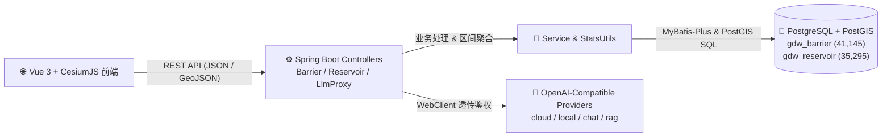

<div align="center">

# 🌊 Global Dam Watch Visualization — Backend

**全球大坝与水库三维可视化系统 · 后端服务**

> 🎓 **武汉科技大学 · 计算机科学与技术学院 · 2026 届本科毕业设计代码**

[](#项目背景)

[](https://openjdk.org/)
[](https://spring.io/projects/spring-boot)
[](https://baomidou.com/)
[](https://postgis.net/)
[](https://spring.io/)
[](https://maven.apache.org/)

[✨ 核心功能](#-核心功能) · [🏗️ 系统架构](#️-系统架构) · [🚀 快速开始](#-快速开始) · [📡 接口文档](#-接口文档) · [📁 目录结构](#-目录结构)

</div>

---

## 🎓 项目背景

> [!NOTE]
> 本仓库为 **武汉科技大学计算机科学与技术学院 2026 届本科毕业设计** 的后端服务端源码。  
> 基于 **Global Dam Watch (GDW)** 全球水库与大坝公开数据集，结合 **Spring Boot + PostgreSQL / PostGIS** 实现大规模地理空间数据的管理、条件筛选与多维聚合统计，并通过 **Spring WebFlux** 提供兼容 OpenAI API 协议的多源大语言模型（LLM）安全代理，支撑前端三维地球可视化与 GIS 智能体交互。

---

## ✨ 核心功能

| 模块 | 功能亮点 |
| :--- | :--- |
| 🌍 **空间位置服务** | 基于 PostGIS `ST_AsGeoJSON` 实时输出全球 **35,295** 座水库（面要素）与 **41,145** 座大坝（点要素）的轻量化 GeoJSON 数据 |
| 🔍 **详情与模糊检索** | 支持按 `gdw_id` 查询完整工程属性，以及按水库/大坝名称进行模糊搜索与快速定位 |
| 🎯 **多维条件筛选** | 支持按流域、主要用途、数据质量、建成年份、国家/地区，以及库容、面积、水深、坝长、坝高等数值区间组合查询 |
| 📊 **多维统计分析** | 按库容、面积、装机功率、主要用途、质量等级、年代区间、国家分布等维度动态生成聚合统计数据 |
| 🗺️ **地图数据同步** | 将结构化筛选条件或智能体生成的筛选结果实时同步为前端 Cesium 所需的精简空间数据集 |
| 🤖 **多源 LLM 安全代理** | 统一代理 OpenAI 兼容格式的 `/chat/completions` 与 `/embeddings` 请求，支持 `cloud`、`local`、`chat`、`rag` 多通道隔离鉴权 |
| 💾 **开箱即用数据集** | 内置 `data/` 目录提供可直接导入 PostgreSQL/PostGIS 的建表、全量数据与空间索引 SQL 脚本 |

---

## 🏗️ 系统架构



---

## 🛠️ 技术栈

| 类别 | 技术组件 | 版本 / 用途 |
| :--- | :--- | :--- |
| **核心语言** | Java | `21` (LTS) |
| **应用框架** | Spring Boot | `3.4.12` |
| **Web 接口** | Spring Web | RESTful API 服务 |
| **响应式代理** | Spring WebFlux | 基于 `WebClient` 的 LLM 请求转发 |
| **持久层** | MyBatis-Plus | `3.5.14` ORM 与自定义空间 SQL |
| **空间数据库** | PostgreSQL / PostGIS | 业务属性存储与地理空间查询 |
| **开发提效** | Lombok / Commons-Lang3 | `1.18.42` / `3.18.0` |
| **构建工具** | Apache Maven | 依赖管理与项目打包 |

> [!TIP]
> 本项目未内置 Maven Wrapper（`mvnw`），运行构建或启动命令前请确保本机已安装并配置好 Maven。

---

## 📋 环境要求

- **JDK**：`21` 或以上
- **Maven**：`3.9+` 或兼容版本
- **数据库**：PostgreSQL（数据脚本导出来源为 PostgreSQL 14）+ **PostGIS** 空间扩展
- **可选依赖**：一个或多个兼容 OpenAI `/chat/completions`、`/embeddings` 协议的大模型服务（如云端 API 或本地 Ollama / vLLM）

默认服务监听端口为 **`8100`**，启动时自动激活 **`dev`** Profile。

---

## 🚀 快速开始

### 1. 初始化 PostgreSQL / PostGIS 数据库

`data/` 目录内置了项目所需的两张核心空间数据表：

| 数据表 | 几何类型 | 记录数 | 对应 SQL 脚本 |
| :--- | :--- | ---: | :--- |
| `public.gdw_barrier` | `POINT, SRID 4326` | `41,145` | `gdw_barrier.sql` |
| `public.gdw_reservoir` | `MULTIPOLYGON, SRID 4326` | `35,295` | `gdw_reservoir_00_schema.sql`、`01`～`05_data.sql`、`99_indexes.sql` |

> [!CAUTION]
> 建表脚本中包含 `DROP TABLE IF EXISTS` 语句，重复执行会清空同名表中的已有数据，执行前请务必确认目标数据库并做好备份。

脚本主键依赖 `gdw_barrier_ogc_fid_seq` 与 `gdw_reservoir_ogc_fid_seq` 序列，首次导入前请先在目标库中启用 PostGIS 扩展并创建序列：

```sql
CREATE EXTENSION IF NOT EXISTS postgis;
CREATE SEQUENCE IF NOT EXISTS public.gdw_barrier_ogc_fid_seq;
CREATE SEQUENCE IF NOT EXISTS public.gdw_reservoir_ogc_fid_seq;
```

随后按顺序使用 `psql` 导入数据（假设数据库名为 `gdw`）：

```bash
psql -d gdw -f data/gdw_barrier.sql
psql -d gdw -f data/gdw_reservoir_00_schema.sql
psql -d gdw -f data/gdw_reservoir_01_data.sql
psql -d gdw -f data/gdw_reservoir_02_data.sql
psql -d gdw -f data/gdw_reservoir_03_data.sql
psql -d gdw -f data/gdw_reservoir_04_data.sql
psql -d gdw -f data/gdw_reservoir_05_data.sql
psql -d gdw -f data/gdw_reservoir_99_indexes.sql
```

> [!TIP]
> `gdw_reservoir_99_indexes.sql` 务必在全部水库分片数据导入完成后执行，用于构建主键约束与 GIST 空间索引。

---

### 2. 配置数据库与大模型参数

公共配置位于 `src/main/resources/application.yml`（默认启用 `dev` Profile）。  
请将模板文件 `src/main/resources/application-dev.yml.example` 复制一份并重命名为 `application-dev.yml`，然后填入实际的数据库与大模型参数（`application-dev.yml` 已被 `.gitignore` 忽略，避免泄露真实密钥）：

```yaml
postgresql:
  url: jdbc:postgresql://localhost:5432/gdw
  username: postgres
  password: <your-db-password>

llm-config:
  cloud:
    base-url: https://api.example.com/v1
    api-key: <your-cloud-llm-api-key>
  local:
    base-url: http://localhost:11434/v1
    api-key: <your-local-llm-api-key>
  chat:
    base-url: https://api.example.com/v1
    api-key: <your-chat-llm-api-key>
  rag:
    base-url: https://api.example.com/v1
    api-key: <your-rag-llm-api-key>
```

也可以通过系统环境变量覆盖配置（Spring Boot 自动将大写下划线映射为配置键）：

```powershell
$env:POSTGRESQL_URL = "jdbc:postgresql://localhost:5432/gdw"
$env:POSTGRESQL_USERNAME = "postgres"
$env:POSTGRESQL_PASSWORD = "change_me"
$env:LLM_CONFIG_LOCAL_BASE_URL = "http://localhost:11434/v1"
$env:LLM_CONFIG_LOCAL_API_KEY = "change_me"
```

> [!IMPORTANT]
> `application.yml` 固定声明了 `cloud`、`local`、`chat`、`rag` 四个 Provider，启动时四组占位符均需可解析。如仅使用部分模型，可在本地 Profile 覆盖 `llm.providers` 或为其余项保留占位值。

---

### 3. 启动与打包

```bash
# 开发模式启动
mvn spring-boot:run

# 编译并打包
mvn clean package

# 跳过测试快速打包
mvn -DskipTests package

# 运行打包产物
java -jar target/backend-springboot-0.0.1-SNAPSHOT.jar
```

启动成功后，服务访问地址为：`http://localhost:8100`

---

## 📡 接口文档

### 统一响应格式

水库与大坝业务接口统一封装为 `Result<T>`（`code` 为 `1` 表示成功，`0` 表示失败）；LLM 代理接口直接透传上游服务的原始响应体与 HTTP 状态码。

```json
{
  "code": 1,
  "message": "success",
  "data": {}
}
```

### 💧 水库接口 (`/reservoir`)

| 方法 | 路径 | 请求体 | 返回说明 |
| :---: | :--- | :--- | :--- |
| `GET` | `/reservoir/location` | 无 | 全部水库的 `gdwId`、`resName`、`yearDam` 及 GeoJSON |
| `GET` | `/reservoir/{id}` | 无 | 指定 `gdw_id` 的水库完整属性及 GeoJSON |
| `POST` | `/reservoir/position` | 纯文本水库名称 | 模糊匹配到的第一条水库记录 |
| `POST` | `/reservoir/filter` | 纯文本 SQL 条件 | 满足条件的精简空间位置数据 |
| `POST` | `/reservoir/stats` | `ReservoirForm` JSON | 筛选后的总量及多维度分组统计 |
| `POST` | `/reservoir/sync` | `ReservoirForm` JSON | 筛选后的精简地图同步数据 |

<details>
<summary>📌 点击查看 <code>/reservoir/stats</code> 与 <code>/reservoir/sync</code> 请求体示例</summary>

```json
{
  "capMcm": { "eq": -1, "gt": -1, "ge": 10, "lt": -1, "le": 1000 },
  "areaSkm": null,
  "mainBasin": ["Yangtze"],
  "mainUse": ["Irrigation"],
  "quality": ["2: Good"],
  "year": [1950, 2020],
  "country": ["China"],
  "depthM": null
}
```

> 响应 `data` 包含 `total`、`capMcm`、`areaSkm`、`mainUse`、`quality`、`yearDam`、`country`，每个分组项为 `{ "name": "分组", "value": 数量 }`。

</details>

### 🧱 大坝接口 (`/barrier`)

| 方法 | 路径 | 请求体 | 返回说明 |
| :---: | :--- | :--- | :--- |
| `GET` | `/barrier/location` | 无 | 全部大坝的 `gdwId`、`damName`、`damType`、`yearDam` 及 GeoJSON |
| `GET` | `/barrier/{id}` | 无 | 指定 `gdw_id` 的大坝完整属性详情 |
| `POST` | `/barrier/position` | 纯文本大坝名称 | 模糊匹配到的第一条大坝记录 |
| `POST` | `/barrier/filter` | 纯文本 SQL 条件 | 满足条件的精简空间位置数据 |
| `POST` | `/barrier/stats` | `BarrierForm` JSON | 筛选后的总量及多维度分组统计 |
| `POST` | `/barrier/sync` | `BarrierForm` JSON | 筛选后的精简地图同步数据 |

<details>
<summary>📌 点击查看 <code>/barrier/stats</code> 与 <code>/barrier/sync</code> 请求体示例</summary>

```json
{
  "damType": ["Dam"],
  "damLenM": null,
  "mainBasin": ["Yangtze"],
  "mainUse": ["Hydroelectricity"],
  "quality": ["2: Good"],
  "year": [1950, 2020],
  "country": ["China"],
  "damHgtM": { "eq": -1, "gt": 20, "ge": -1, "lt": -1, "le": -1 }
}
```

> 响应 `data` 包含 `total`、`damType`、`powerMw`、`mainUse`、`quality`、`yearDam`、`country`。

</details>

#### 📐 数值区间筛选规则 (`RangeData`)

`capMcm`、`areaSkm`、`depthM`、`damLenM`、`damHgtM` 共用同一区间结构：

| 字段 | `eq` | `gt` | `ge` | `lt` | `le` |
| :---: | :---: | :---: | :---: | :---: | :---: |
| **含义** | 等于 (`=`) | 大于 (`>`) | 大于等于 (`>=`) | 小于 (`<`) | 小于等于 (`<=`) |

- 某字段值为 `-1` 表示不启用该条件；整个区间对象为 `null` 表示不对该指标筛选。
- `year` 接收 `[起始年份, 结束年份]` 闭区间数组。

### 🤖 LLM 代理接口 (`/api/llm`)

| 方法 | 路径 | 说明 |
| :---: | :--- | :--- |
| `POST` | `/api/llm/{provider}/chat/completions` | 转发至对应 Provider 的 `/chat/completions` |
| `POST` | `/api/llm/{provider}/embeddings` | 转发至对应 Provider 的 `/embeddings` |

- `provider` 支持 `cloud`、`local`、`chat`、`rag`；未知 Provider 返回 `HTTP 400`。
- 代理自动附加 `Authorization: Bearer <api-key>` 与 `Content-Type: application/json`。
- `base-url` 需包含公共 API 前缀（通常为 `/v1`），无需包含 `/chat/completions` 或 `/embeddings`。

> [!WARNING]
> **安全提示**：`/reservoir/filter` 与 `/barrier/filter` 会将请求体作为 SQL `WHERE` 条件拼接执行（用于配合前端 GIS 智能体动态筛选），存在 SQL 注入风险，仅限本地开发或可信内网调用。生产部署前请务必增加鉴权、字段白名单校验、收紧 `@CrossOrigin(origins = "*")` 跨域范围，并关闭 MyBatis `StdOutImpl` 控制台 SQL 日志。

---

## 📁 目录结构

```text
global-dam-watch-visualization-backend/
├─ data/                                          # PostGIS 建表、全量数据与索引 SQL 脚本
├─ src/main/
│  ├─ java/org/example/backendspringboot/
│  │  ├─ common/                                  # 统一响应、区间模型、统计结构与 LLM 配置类
│  │  ├─ config/                                  # WebClient 多 Provider 注册配置
│  │  ├─ controller/                              # Barrier / Reservoir / LlmProxy 控制器
│  │  ├─ dto/                                     # 筛选表单与统计结果传输对象
│  │  ├─ entity/                                  # gdw_barrier 与 gdw_reservoir 数据实体
│  │  ├─ mapper/                                  # MyBatis-Plus Mapper 与空间查询 SQL
│  │  ├─ service/                                 # 业务接口及实现类
│  │  └─ util/                                    # 统计分组与区间查询工具类
│  └─ resources/
│     ├─ application.yml                          # 公共配置（默认启用 dev Profile）
│     └─ application-dev.yml.example              # 开发环境配置模板（复制为 application-dev.yml 后填写真实配置）
├─ pom.xml                                        # Maven 项目配置
└─ README.md
```

---

## 📝 实现细节说明

- **空间几何转换**：水库 `wkb_geometry` 在位置与详情接口均经 `ST_AsGeoJSON` 转换；大坝 `wkb_geometry` 在位置与筛选接口转换，详情接口默认不返回几何字段。
- **统计清洗规则**：分类统计自动过滤空字符串与缺失值标记 `-99`，区间统计同样忽略 `-99`。
- **预置统计分桶**：
  - 库容 / 面积 / 装机功率：`<1`、`1-10`、`10-100`、`100-1000`、`>1000`
  - 建成年份：`<1900`、`1900-1920`、`1920-1940`、`1940-1960`、`1960-1980`、`1980-2000`、`>2000`

---

<div align="center">

**Global Dam Watch Visualization Backend**  
🎓 武汉科技大学计算机科学与技术学院 2026 届本科毕业设计作品

</div>
